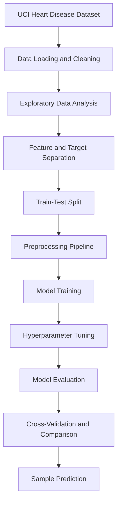

# ❤️ Heart Disease Prediction Using Machine Learning

A machine learning project that analyzes clinical health parameters and builds predictive models to identify the presence of heart disease. The project combines exploratory data analysis, data preprocessing, model training, hyperparameter tuning, and performance evaluation to compare multiple classification algorithms.


## 📌 Project Overview

Heart disease is a major health concern worldwide. Machine learning can help analyze clinical data and identify patterns associated with heart disease.

This project uses the Cleveland Heart Disease dataset to train and evaluate several classification models. Their performance is compared using accuracy, precision, recall, F1-score, ROC-AUC, confusion matrices, and cross-validation.

The project also includes hyperparameter tuning, visual data analysis, and a sample prediction pipeline.

## 🎯 Project Objectives

- Analyze clinical features associated with heart disease.
- Perform exploratory data analysis (EDA) to discover patterns and relationships.
- Build a robust preprocessing pipeline for numerical and categorical variables.
- Train and compare multiple machine learning classification algorithms.
- Optimize model parameters using GridSearchCV.
- Evaluate model performance using multiple metrics and cross-validation.
- Generate predictions and probability estimates for new patient records.

## 📊 Dataset

**Dataset:** UCI Heart Disease — Cleveland subset

**Source:** [UCI Machine Learning Repository](https://archive.ics.uci.edu/dataset/45/heart+disease)

- **Records:** 303
- **Input features:** 13
- **Target variable:** Binary classification
- **Task:** Predict the presence or absence of heart disease

The original target values are converted into two classes:

- `0` — No heart disease indicated by the dataset
- `1` — Heart disease indicated by the dataset

### Features Used

| Feature | Description |
|---|---|
| `age` | Age in years |
| `sex` | Sex |
| `cp` | Chest pain type |
| `trestbps` | Resting blood pressure |
| `chol` | Serum cholesterol |
| `fbs` | Fasting blood sugar indicator |
| `restecg` | Resting electrocardiographic results |
| `thalach` | Maximum heart rate achieved |
| `exang` | Exercise-induced angina |
| `oldpeak` | ST depression induced by exercise |
| `slope` | Slope of the peak exercise ST segment |
| `ca` | Number of major vessels visualized |
| `thal` | Thalassemia-related test result |

## ⚙️ Project Workflow



## 🔍 Exploratory Data Analysis

The project investigates the dataset through visualizations and statistical analysis, including:

- Target-class distribution
- Numerical feature distributions
- Boxplots comparing features across target classes
- Correlation heatmap
- Categorical feature frequency plots
- Identification of missing values and potential data-quality issues

These analyses help understand the structure of the dataset and the relationships between clinical features and the target variable.

## 🛠️ Data Preprocessing

The project uses Scikit-learn pipelines and a `ColumnTransformer` to organize preprocessing.

- **Numerical features:** Mean imputation and standard scaling.
- **Categorical features:** One-hot encoding with `handle_unknown="ignore"` and `drop="first"`.
- **Binary features:** Passed through the preprocessing pipeline.
- **Missing values:** The dataset's `?` markers are converted to missing values and handled during preprocessing where configured.
- **Train-test split:** 80% training and 20% testing, using stratification and `random_state=42`.

This structure helps maintain consistent transformations between model training and prediction.

## 🤖 Machine Learning Algorithms

The following models are implemented and compared:

1. **Logistic Regression** — A linear classification baseline.
2. **Random Forest Classifier** — An ensemble of decision trees.
3. **Support Vector Machine (RBF Kernel)** — A nonlinear classification model.
4. **XGBoost Classifier** — A gradient-boosted decision-tree model.
5. **Tuned XGBoost Classifier** — XGBoost optimized using GridSearchCV.

### Hyperparameter Tuning

GridSearchCV is used to search for improved XGBoost configurations.

The recorded tuned configuration includes:

```python
{
    "n_estimators": 300,
    "learning_rate": 0.03,
    "max_depth": 4,
    "subsample": 1.0,
    "colsample_bytree": 0.8,
    "reg_lambda": 2.0
}
```

## 📈 Model Performance

The following results are recorded in the notebook's saved test-set outputs. The test set contains 61 records.

| Model | Accuracy | Precision | Recall | F1-Score | ROC-AUC |
|---|---:|---:|---:|---:|---:|
| Logistic Regression | 85.2% | 80.6% | 89.3% | 84.7% | 0.9567 |
| Random Forest | 88.5% | 83.9% | 92.9% | 88.1% | 0.9426 |
| SVM (RBF) | **93.4%** | **90.0%** | **96.4%** | **93.1%** | **0.9665** |
| XGBoost | 88.5% | 83.9% | 92.9% | 88.1% | 0.9426 |
| Tuned XGBoost | 90.2% | 86.7% | 92.9% | 89.7% | 0.9416 |

**Best recorded holdout result:** The SVM with an RBF kernel achieved 93.4% accuracy and a ROC-AUC of 0.9665 on the notebook's test set.

These are results from one train-test split, not a guarantee of performance on new populations or clinical data.

### Cross-Validation Results

The notebook also records five-fold stratified cross-validation results.

| Model | Mean ROC-AUC | Standard Deviation |
|---|---:|---:|
| Logistic Regression | 0.9148 | 0.0212 |
| Random Forest | 0.9115 | 0.0222 |
| SVM (RBF) | 0.8993 | 0.0354 |
| XGBoost | 0.8905 | 0.0195 |

Cross-validation provides an additional view of model performance across different data splits. The best single holdout result and the best mean cross-validation result are different measures and should be interpreted separately.

## 📉 Evaluation Techniques

Model performance is assessed using:

- Accuracy
- Precision
- Recall
- F1-score
- ROC-AUC
- Confusion matrices
- ROC curves
- Five-fold stratified cross-validation

Using multiple metrics provides a more complete comparison than accuracy alone, particularly when evaluating classification errors.

## 🧪 Sample Prediction

The notebook demonstrates inference using a sample record with these values:

- Age: 45
- Resting blood pressure: 130
- Cholesterol: 230
- Maximum heart rate: 170

The recorded prediction for this sample is class `0`, with an estimated probability of `0.142` for the positive class.

This is an example from the notebook, not a medical assessment of an actual patient.

## 💻 Technologies Used

| Technology | Purpose |
|---|---|
| Python | Core programming language |
| Pandas | Data manipulation |
| NumPy | Numerical operations |
| Matplotlib | Data visualization |
| Seaborn | Statistical visualization |
| Scikit-learn | Preprocessing, model training and evaluation |
| XGBoost | Gradient boosting |
| Jupyter Notebook | Interactive analysis and experimentation |

## 📁 Repository Structure

```text
Heart-Disease-Prediction/
│
├── README.md
├── requirements.txt
├── .gitignore
│
├── notebooks/
│   └── Heart_Disease_Prediction.ipynb
│
└── docs/
    └── REPORT_PUBLICATION_NOTE.md
```

## 🚀 Installation and Usage

### 1. Clone the Repository

```bash
git clone https://github.com/YOUR-USERNAME/Heart-Disease-Prediction.git
cd Heart-Disease-Prediction
```

Replace `YOUR-USERNAME` with your GitHub username.

### 2. Create a Virtual Environment

```bash
python -m venv venv
```

Activate it:

**Windows**
```bash
venv\Scripts\activate
```

**macOS / Linux**
```bash
source venv/bin/activate
```

### 3. Install Dependencies

```bash
pip install -r requirements.txt
```

### 4. Run the Notebook

```bash
jupyter notebook
```

Open `notebooks/Heart_Disease_Prediction.ipynb` and run the cells in order.

**Note:** The notebook includes dataset-download and fallback logic. Review its data-loading and output-path cells before running it in a local environment, because some paths may be specific to Google Colab.


## 👨‍💻 Author

**Manoj Bhorge**

BBA-CA Graduate | Machine Learning | Python | Data Analysis

GitHub: https://github.com/manojBhorge07

LinkedIn: https://in.linkedin.com/in/manoj-bhorge-630a81287


**Disclaimer:** This project demonstrates machine learning techniques for heart disease classification. Its predictions are not clinically validated and should not be used to make medical decisions.
